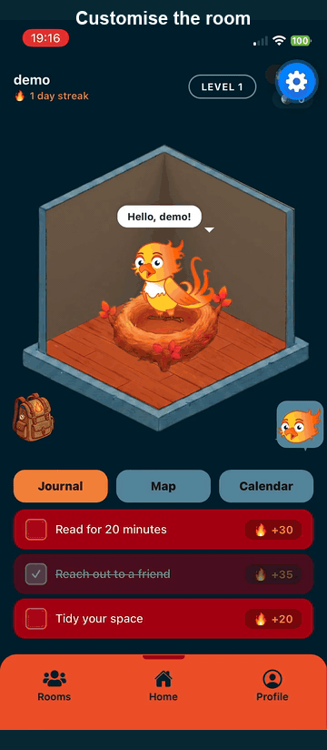
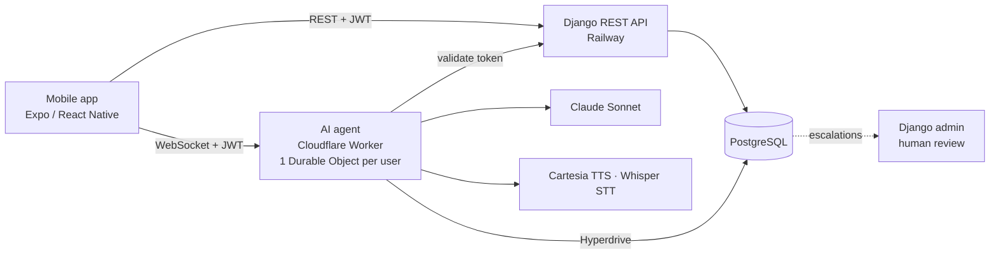

# Riser

A gamified mental-wellness app. You raise a virtual bird, complete small daily wellness tasks, journal, talk to an AI companion, and book sessions with human therapists.

Built as a team project at ISCTE. **The source code is private** (team project); this repo documents what it does and how it works.

  

<h3 align="center">Demo (2:30)</h3>

  https://github.com/user-attachments/assets/e3071281-09be-42ae-a5b9-2e089ca21ce3

  <b><a href="#">Try the Android app</a></b> · Demo account: <code>demo@riser.app</code> / <code>demo1234</code>

---

## What it does

- **Riser and Nest:** a bird avatar and a customizable room that grow as you build habits.
- **Daily tasks and coins:** three small wellness tasks a day, with coins and XP for finishing them.
- **Journal:** mood-tagged entries.
- **AI companion:** a chat (text and voice) that remembers what you said before, runs short breathing and grounding exercises, tracks which ones help, books therapy sessions with your approval, and flags a session for human review if you may be in crisis.
- **Therapy sessions:** group sessions for everyone, individual sessions for premium users.

## My role

I built the **backend**, the **AI agent** and the **infrastructure**, and designed some of the screens.

| Area | What I did |
|---|---|
| Backend | Django REST API, PostgreSQL schema and migrations, JWT auth with rotating refresh tokens, per-email throttling on verification codes, tests and CI |
| AI agent | Cloudflare Worker with one Durable Object per user, Claude Sonnet, 14 database-backed tools, voice in and out |
| Infrastructure | Docker Compose stack, Railway deployment, Hyperdrive connection from the Worker to Postgres, GitHub Actions |
| Design | Several mobile screens |

The mobile app and the rest of the screens were built by teammates.

## Architecture

Django owns the schema and issues the tokens. The Worker never trusts a client: on every WebSocket connect it sends the token to Django, and the Durable Object's name must match the returned user id, so one user can't open another user's agent.

## Engineering highlights

**One identity across two runtimes.** The Django-issued JWT is checked by the Worker on every connection. Refresh tokens rotate and the old one is blacklisted; on the app, a single-flight refresh stops simultaneous requests from logging the user out.

**An agent with real tools, not just a prompt.** Fourteen tools read and write the same Postgres the app uses: profile, appointments, availability, exercise feedback, preferences, escalation. Booking needs the user's approval, then runs in one transaction that locks the slot, checks premium, and reads the time and duration from the slot itself, not from the model.

**Crisis handling that doesn't get rate-limited.** Messages are limited per user, but once the agent escalates a session the limit is lifted. An escalation writes an urgent row that a human sees in the admin, and the agent gives local emergency numbers.

**Voice.** The agent can switch to spoken mode for someone who is too overwhelmed to type: text-to-speech out (mp3 over the socket), speech-to-text in.

**Security hardening.** Debug off by default, host and CORS allow-lists from the environment, throttles on the email-code endpoints, server-owned fields on sign-up, secrets kept out of the repo, and a CI job that runs the backend tests and the TypeScript check.

**Database-first agent.** Using Hyperdrive means the Worker queries the production database directly with low latency, with one short-lived connection per chat turn.

## Status

| Feature | Status |
|---|---|
| Accounts, email verification, login | Done |
| Riser, Nest, daily tasks, coins, journal | Done |
| AI chat (text and voice), exercise loop, preferences | Done |
| Group and individual booking through the agent | Done |
| Crisis escalation visible to staff (Django admin) | Done |
| Therapist-facing screens and notifications | Not built yet |
| Payments and premium purchase flow | Not built yet |
| In-app booking screens | In progress |
| Shop | Not built yet |
| Zoom links for sessions | Not built yet |
| Therapist matching | Not built yet |
| Semantic memory for the agent | Not built yet |

## Stack

React Native (Expo) · Django REST Framework · PostgreSQL · Redis · Cloudflare Workers, Durable Objects and Hyperdrive · Claude (Anthropic) · Cartesia · Docker · Railway · GitHub Actions

## What I'd do next

A therapist console for escalations with notifications, semantic memory so the agent recalls older conversations, tests for the Worker, and moving the booking flow into the app UI.

---

*The AI companion is not a therapist and not a medical device. It points people to human help and emergency services.*
